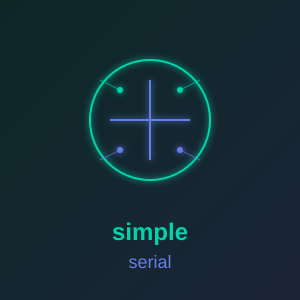

<p align="center">
  
</p>

# simple_serial

**[Documentation](https://simple-eiffel.github.io/simple_serial/)** | **[GitHub](https://github.com/simple-eiffel/simple_serial)**

[](https://opensource.org/licenses/MIT)
[](https://www.eiffel.org/)
[]()
  

Cross-platform serial port communication library for Eiffel.

Part of the [Simple Eiffel](https://github.com/simple-eiffel) ecosystem.

## Status

**Phase 1** - 7 tests passing on Windows, macOS and Linux

## Overview

SIMPLE_SERIAL provides serial port (COM port) communication for Eiffel applications. It uses inline C externals: Win32 calls on Windows, termios on macOS and Linux. Supports configurable baud rates, parity, stop bits, and flow control with a fluent builder API.

## Quick Start

```eiffel
local
    serial: SIMPLE_SERIAL
    port: detachable SERIAL_PORT
do
    create serial
    port := serial.open_port ("COM3")  -- macOS: "/dev/cu.usbserial-1410", Linux: "/dev/ttyUSB0"

    if attached port as p then
        if p.write_string ("Hello device!") then
            print (p.read_string (100))
        end
        p.close
    end
end
```

## Configuration

```eiffel
local
    config: SERIAL_PORT_CONFIG
do
    create config.make_default
    config := config
        .set_baud_rate (115200)
        .set_data_bits (8)
        .set_parity ({SERIAL_PORT_CONFIG}.parity_none)
        .set_stop_bits ({SERIAL_PORT_CONFIG}.stop_bits_one)
        .set_flow_control ({SERIAL_PORT_CONFIG}.flow_control_hardware)

    port := serial.open_port_with_config ("COM3", config)
end
```

## Port Discovery

```eiffel
-- List available ports
across serial.available_ports as p loop
    print (p + "%N")
end

-- Find Bluetooth devices (paired via OS)
across serial.bluetooth_ports as p loop
    print ("Bluetooth: " + p + "%N")
end

-- Find USB serial adapters
across serial.usb_ports as p loop
    print ("USB: " + p + "%N")
end
```

## Features

- **Cross-platform API** - Windows, macOS and Linux
- **Configurable settings** - Baud rate, data bits, stop bits, parity, flow control
- **Fluent builder** - Chain configuration calls for clean code
- **Port enumeration** - Discover available ports (skips Linux built-in `ttyS*` ports)
- **Bluetooth-aware** - Identify Bluetooth SPP and USB serial devices
- **Design by Contract** - Full preconditions/postconditions
- **SCOOP compatible** - Concurrency-ready design

## Classes

| Class | Description |
|-------|-------------|
| `SIMPLE_SERIAL` | Main facade with factory methods |
| `SERIAL_PORT` | Port handle for read/write operations |
| `SERIAL_PORT_CONFIG` | Configuration (baud, parity, etc.) |
| `SERIAL_PORT_ENUMERATOR` | Discover available ports |

## Installation

1. Set the ecosystem environment variable (one-time setup for all simple_* libraries):
```
SIMPLE_EIFFEL=D:\prod
```
On macOS or Linux:
```bash
export SIMPLE_EIFFEL=$HOME/simple_eiffel
```

2. Add to ECF:
```xml
<library name="simple_serial" location="$SIMPLE_EIFFEL/simple_serial/simple_serial.ecf"/>
```

## Dependencies

None (uses only ISE standard libraries: base, time)

## Requirements

- EiffelStudio 25.02+
- Windows 10+, macOS or Linux (Linux users need access to the port, usually the `dialout` group). 1.5 stop bits and mark/space parity work only on Windows. Linux takes standard baud rates only.
- Off Windows, one test does a real round trip over a pseudo-terminal.

## License

MIT License
